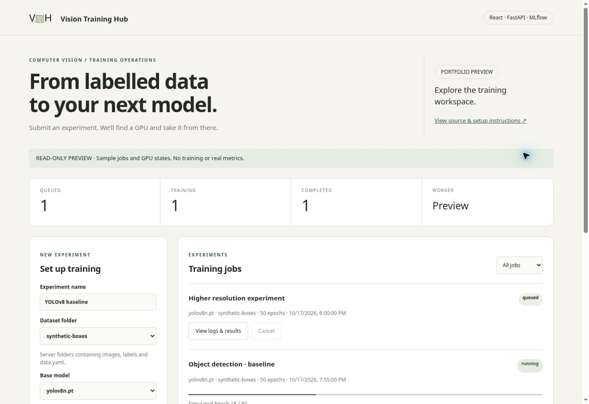
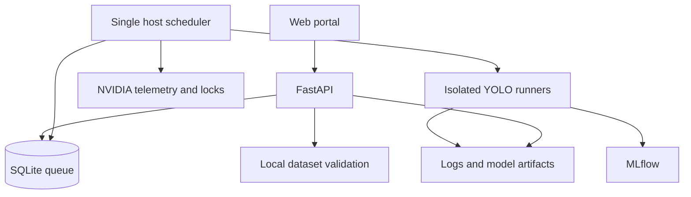

# Vision Training Hub

A **React + FastAPI** web portal for training **Ultralytics YOLOv8 detection models** on labelled image datasets. Submit a job, let the scheduler assign an available NVIDIA GPU, and inspect progress, logs, model weights and MLflow experiments from one workflow.

Built by [Dr. Muhammad Zohaib Jan](https://zohaibjan.github.io/). This is a new, independent reference implementation of a training-platform concept described by the author. It contains no employer or client code or data and makes no claims about historical deployment results.

[Open the read-only portal preview](https://zohaibjan.github.io/vision-training-hub-demo/?preview=1)



*Screenshot of the actual React interface in read-only preview mode. The displayed jobs and GPUs are sample states, not training results.*

## What it does

- Select a server-side dataset folder containing images, YOLO labels and `data.yaml`.
- Validate image files, labels, class IDs and dataset paths; fingerprint dataset contents.
- Submit jobs to a persistent SQLite FIFO queue.
- Check NVIDIA GPU memory, utilization, compute processes and local reservations.
- Run **one job per GPU**, concurrently across available GPUs; wait when all are busy.
- Track queued, starting, running, completed, failed, cancelled and interrupted jobs.
- View epoch progress, metrics, bounded log tails and downloadable weights/results.
- Enable Ultralytics' native MLflow integration for training parameters, losses, validation metrics and artifacts. Associate each job with a stable MLflow run ID.
- Exercise the portal and queue using a clearly labelled simulation mode without CUDA.

## Quick start — simulation (Linux, Python 3.11+)

```bash
git clone https://github.com/zohaibjan/vision-training-hub.git
cd vision-training-hub
python -m venv .venv
source .venv/bin/activate
pip install -e '.[dev]'
python scripts/make_demo_dataset.py
export HUB_MODE=demo
export HUB_API_TOKEN="$(python -c 'import secrets; print(secrets.token_urlsafe(32))')"
# Retain this token locally to enter into the portal; use the same environment in both terminals.
python -m hub.worker
```

In a second terminal, activate the same environment, set the **same** `HUB_MODE`, `HUB_API_TOKEN`, dataset root and state directory, then run:

```bash
uvicorn hub.api:create_app --factory --host 127.0.0.1 --port 8000
```

Open **http://127.0.0.1:8000**, enter your token, select `synthetic-boxes`, and submit a short experiment. Simulation exposes two virtual GPUs, exercises the real queue and subprocess lifecycle, and creates **no trained weights, MLflow runs or invented accuracy metrics**. Closing the browser does not stop the worker.

## React frontend development

The frontend source is in `frontend/src/`, with React 19 and a Vite build. FastAPI serves the committed production build in `hub/static/`; a fresh clone runs without Node. Node 22+ is required only for frontend development/rebuilding.

```bash
cd frontend
npm ci
npm test
npm run build
```

The build replaces `hub/static/`. Commit the source, lockfile and matching build together. For development, run `npm run dev` with FastAPI on port 8000; Vite proxies `/api` to FastAPI. The frontend keeps the bearer token in memory, aborts stale requests on disconnect/unmount, and polls jobs without overlapping requests.

The public preview uses this same React build with `?preview=1`. It performs no API calls and disables training/cancellation. Actual training requires the local FastAPI service, worker and NVIDIA host.

## Real GPU training

1. Use a Linux host with NVIDIA drivers and a CUDA-compatible PyTorch installation. Check `nvidia-smi` and `torch.cuda.is_available()` first. Follow [PyTorch's installation selector](https://pytorch.org/get-started/locally/) for your system.
2. Install training dependencies: `pip install -e '.[train]'`.
3. Start MLflow in a separate terminal from the repository root:

   ```bash
   mkdir -p state/mlflow
   mlflow server --host 127.0.0.1 --port 5000 \
     --backend-store-uri sqlite:///state/mlflow/mlflow.db \
     --default-artifact-root "$(pwd)/state/mlflow/artifacts"
   ```

4. Set `HUB_MODE=real`, `MLFLOW_TRACKING_URI=http://127.0.0.1:5000`, and `HUB_API_TOKEN` in the worker/API environments. Use the same absolute state and dataset paths in both processes.
5. Place your dataset below `HUB_DATASETS_DIR`, then start the worker and API as above.
6. Inspect jobs in the portal and runs at **http://127.0.0.1:5000**. The job details show the exact run ID for comparison in MLflow.

The worker sets `CUDA_VISIBLE_DEVICES` to the selected **GPU UUID** before importing PyTorch/Ultralytics. Training uses logical `device=0` within that isolated view. This is concurrent independent single-GPU training, not distributed multi-GPU training of one model.

The first run may download the selected official YOLOv8 pretrained weights. Only the five allowlisted YOLOv8 detection models can be selected; arbitrary uploaded checkpoints are not accepted.

### Dataset layout

```text
datasets/my-dataset/
  data.yaml
  images/train/*.jpg
  images/val/*.jpg
  labels/train/*.txt
  labels/val/*.txt
```

```yaml
# data.yaml — paths are relative to this file; omit path or use path: .
train: images/train
val: images/val
names: [person, vehicle]
```

Each label line is `class_id x_center y_center width height`, with normalized coordinates and class IDs starting at 0. Use an empty label file for a background image; each split needs at least one labelled object. Missing labels, remote paths, YAML download hooks, path escapes and overlapping split files are rejected. This edition supports detection boxes, not segmentation masks, pose or classification datasets.

The browser selects folders **on the training server**, not on a visitor's laptop. Mount or copy datasets to the server first. Full content validation/hashing occurs on submission and before launch; treat accepted datasets as immutable while training. For large datasets, these checks take time and consume disk I/O.

## Configuration

| Variable | Default | Purpose |
| --- | --- | --- |
| `HUB_MODE` | `real` | `real` or explicit `demo` simulation |
| `HUB_API_TOKEN` | unset | Required bearer token for all data and control APIs |
| `HUB_STATE_DIR` | `./state` | SQLite queue, GPU locks, job logs and outputs |
| `HUB_DATASETS_DIR` | `./datasets` | Approved dataset root |
| `MLFLOW_TRACKING_URI` | `http://127.0.0.1:5000` | MLflow tracking service |
| `HUB_MIN_FREE_MB` | `4096` | Minimum free GPU memory to consider scheduling |
| `HUB_MAX_GPU_UTIL` | `10` | Maximum utilization percentage before dispatch |

Available memory is a scheduling threshold, not a guarantee that a model/batch fits. CUDA out-of-memory errors produce failed jobs with logs. Reduce batch/image/model size and submit again.

## Queue and recovery guarantees

SQLite transactions serialize FIFO claims and enforce one active reservation per GPU. A process lock allows only one scheduler per state directory, and inherited GPU locks survive unexpected scheduler death while a child is still running. A launch handshake records child identity before allowing training. Jobs keep their original configuration and dataset fingerprint.

Cancel requests are persistent: queued jobs cancel immediately; active jobs receive SIGTERM, then SIGKILL after a grace period. Graceful worker shutdown interrupts its jobs. On restart, verified previous training process groups are terminated and their jobs marked interrupted; jobs are **not automatically resumed or retried**. Unknown process identity is never guessed: inherited locks/external GPU telemetry prevent scheduling onto a still-running child. Use a normal host PID namespace for recovery support.

Scheduler reservations coordinate this application only. An unrelated process can still claim GPU resources after a probe. Use a dedicated training host; Kubernetes/Slurm would be the next step for cluster-wide allocation. MIG-enabled GPUs are excluded in this version.

## MLflow behavior

Ultralytics includes native MLflow callbacks, but **MLflow must be installed and `settings['mlflow']` enabled**. Each isolated runner enables it explicitly, starts an outer run, and writes its run/experiment IDs before training. The callbacks log epoch metrics and parameters; the runner also uploads final training outputs and records success/failure. A tracking failure can fail a job; the local logs and output directory remain available. Forced termination can leave an MLflow run in RUNNING state; the portal job status is authoritative and operators should reconcile abandoned runs.

See [Ultralytics MLflow documentation](https://docs.ultralytics.com/integrations/mlflow/) and [callback implementation](https://docs.ultralytics.com/reference/utils/callbacks/mlflow/).

## Architecture



## Tests and limitations

```bash
pip install -e '.[dev]'
pytest -q
npm ci --prefix frontend
npm test --prefix frontend
npm run build --prefix frontend
```

The suite contains **38 Python tests and 13 React tests**. Tests cover authenticated APIs, label/path validation, atomic claims, busy GPU queuing, multiple simulated GPUs, real subprocess completion/cancellation, dataset changes, restart state, artifact access the MLflow adapter contract, React authentication/submission/filtering/cancellation, log display, authenticated downloads, preview isolation and polling cleanup. No GPU is needed for these tests. **Real NVIDIA training and end-to-end Ultralytics/MLflow metrics require hardware acceptance testing**; adapter tests use fakes and are not evidence of model accuracy or throughput. See [the acceptance checklist](docs/acceptance.md).

This is a single-host reference implementation, not a multi-tenant hosted service. Bind API and MLflow to loopback; for remote use, use an SSH tunnel or an authenticated TLS proxy. There are no user accounts, quotas, automatic retention, resume checkpoints, distributed locks, Kubernetes integration or automatic retries. Logs and MLflow artifacts can contain dataset paths; only trusted operators should have access. Keep token/state/datasets out of Git. Back up SQLite and outputs while the worker is stopped.

## License

AGPL-3.0-or-later. Ultralytics has its own licensing terms; review those for your intended deployment. This project is not affiliated with or endorsed by Ultralytics or MLflow.
